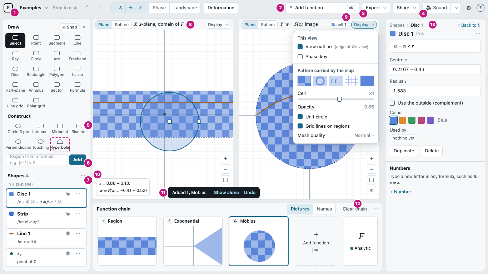
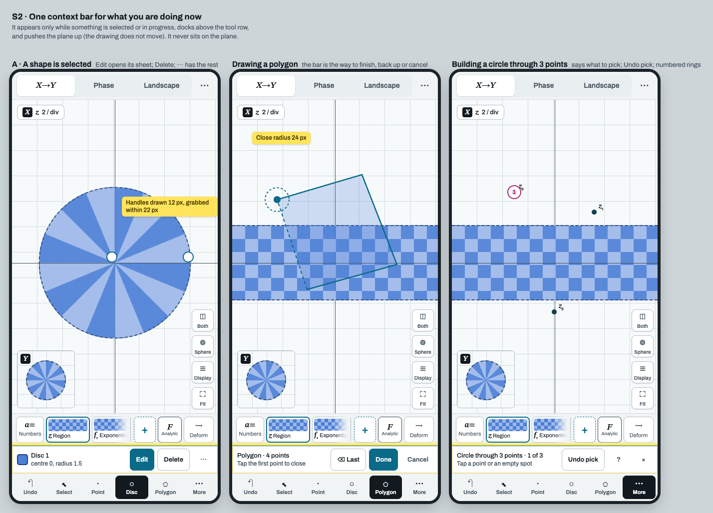

# Roadmap

**Live now:** v17.0-beta.11 (waves 1–11, 30 October 2026): the redesign so far, complex shared numbers, iteration, fast
Dirichlet series, the ES-module build, shapes and parameter points in every plane, exact preimages of a parameter point
on rational chains, the phone's step bar and its ‹ › glide, an offline page you can download, Try lines that close
themselves, the tour strip's new look, screen-reader and 24 px target fixes, evenly lit globes, a Landscape that opens
much faster on Windows, and the large source files split into parts and modules.

**Next:** v17.0-beta.12 (wave 12: the tour's Russian task titles and a task for the Phase portrait step (#424), the strip at
52 px on the laptop (#431), `inverse.js` in modules (#432), more type checks (#430), the slowest browser shard split in two
(#429), the `// v15:` label sweep, and, when the Windows laptop is back, #170, #238 and #350), then v17.0, when the touch rules (#30) and the guided tour
rework (#34) are done; until then each merged wave is a beta (v17.0-beta.12, …). After v17.0 come v17.x releases. v17 is a redesign of how the app is laid out and learned. v16.5 and v17 both come from a usability audit of
every function on laptops and Android phones: [plan/ux-audit/REPORT.md](plan/ux-audit/REPORT.md) (106 problems, 17
of them serious, each with its fix; step counts for 43 common tasks; mockups of every option).

## Where we are

| Version | What | Status |
|---|---|---|
| v16.4.1 | Landscape walls, docked tour, hyperbolic lines | published |
| v16.5 | The fixes that need no decision, snapping and railing of points | shipped (2026-10-27) |
| v17 | The twelve layout decisions (D1–D12) and the new guided tour | in progress: v17.0-beta.11 is live; v17.0 waits for #30 and #34 |
| patch | Landscape walls redesign | in progress: the edge pass runs in the surface's own program (#168, #47); the Max mesh at 60 fps (#48, #170) waits for a Windows measurement |

## Releases

Each merged wave is a release. Dates are the day the wave PR merged into `main` (UTC).

| Version | Date | Wave PR | What it brought |
|---|---|---|---|
| v16.4.1 | 2026-10-27 | #1, #2 | Windows performance (ANGLE Direct3D 11) and an Italian interface |
| v16.5 | 2026-10-27 | #14 | Snapping and railing of points, and a round of fixes |
| v16.6 | 2026-10-28 | #80 (tag on its merge, 68c4f73) | CI and browser-suite fixes; no wave |
| v17.0-beta.1 | 2026-10-28 | #93 | #20 phases 1–3 (lint, types, the split of `app.js` and `gl.js`) and 18 fixes |
| v17.0-beta.2 | 2026-10-28 | #115 | Γ and ζ, the laptop keyboard, layout decisions D2, D4, D8, D11 and #37, #38, #41 |
| v17.0-beta.3 | 2026-10-28 | #150 | Modules and state functions, Settings and the header, D1 and D10, polygons, overlapping shapes, walls, the tour and guide |
| v17.0-beta.4 | 2026-10-29 | #182 | Series functions, phone D3 and D6, export D12, #20 step 5, the glossary, tour fixes |
| v17.0-beta.5 | 2026-10-29 | #221 | Complex shared numbers (#10), the Recurrence step and Repeat × N (#6), shader-compile work for Windows (#72), touch rules (#30, touch half), tour lane (#34), ES-module preparation (#20) |
| v17.0-beta.6 | 2026-10-29 | #268 (3eb5fb3) | Iteration complete (#6: `iter()`, Mandelbrot, Julia and Newton examples, Repeat × N on one GPU loop), shared numbers in a series' a_n and a recurrence's rule, Dirichlet series correct and about 100× cheaper (#242), Between z₀ and z₁ (#70), Alt and Space on a laptop (#30), the Phase style one click away (#81), one chain walk per shader program (#72 C) |
| v17.0-beta.7 | 2026-10-29 | #304 (e6830d9) | The ES-module switch (#20 phase 4), Hear the function (#234), ζ about 3× cheaper, series edits and number drags without the lag (#243), shapes in a step's plane, forward (#253), a start-up progress bar (#245), Display options without a pop-up (#247), no wordmark in the top bar, a faster tour (#250), Windows GLSL in ten jobs (#169) |
| v17.0-beta.8 | 2026-10-30 | #346 (62eb93c) | The Douady–Hubbard map Φ_M with external rays and equipotentials (#260), the Cauchy style by the residue theorem with three Cauchy examples 1/z, z + 1/z, e^{1/z} (#235, #293), shapes and parameter points shown in every plane (#253, #252), the phone's chain as ‹ the step › with a sheet and a glide through the deformation (#246), phone sheets and landscape phones fixed (#251), Display options as glyphs only (#247), pane heads laid out once per task (#320), Landscape step cards that never block on a link (#72), a phone selection sheet that reads a shape's description as plain text (#321), tests for complex shared numbers in a_n and recurrences (#327), CodeQL with an advanced setup that leaves test/ out (#330), a quality harness that settles on the right pane's own frame |
| v17.0-beta.9 | 2026-10-30 | #386 (d598403) | Exact preimages of a parameter point on rational chains, with every preimage listed and following a drag (#291), the line refinement sliced so one slow curve no longer blocks a frame (#325), no Phase style button in the top bar, the style row as glyphs in each plane's head and the view tabs centred (#334, #335), Inspector labels as Unicode, not raw TeX (#336), the Height and Colour keys' pop-up below the readout (#337), the pane heads at 1024 px (#356, #357), the Φ_M card's fields (#358), screen readers and 24 px targets (axe-core suite; #359, #360, #361), every globe lit evenly from the camera (#287), no ghost cut handle after an example switch (#297), the first audio gesture's context created after the click (#271), the Gate that reuses a green push run (#379), the ES-module cleanup and a file-size budget (#20) |
| v17.0-beta.10 | 2026-10-30 | #409 (6a22f6c) | An offline page, `complex-map-workbench-offline.html`, published next to the live page and downloadable from Settings (the Menu sheet on the phone) (#21, #393), Phase's colour key always on the plot, top right (#365), the phone's ‹ › gliding Y between the steps' planes with no transport, and an export that saves the plane Y shows (#362, #383), every example's Try line closing itself once you do what it asks (#34, #398), a typed Repeat N or step field that stays with its own step through a chain switch (#401, #404), smaller Windows shader programs: the Mountain King's mode-1 program 126 KB instead of 492 KB (#355), Julia's preimage program (#396), and the Landscape's edge pass inside its own program (#47), a fuzz test of exact preimages (#291), Examples first in Tab order (#359), and `notes/` without its old screenshots and PDFs (#20) |
| v17.0-beta.11 | 2026-10-30 | #433 (#TBD) | The Landscape's first open faster on Windows: the Mountain King's edge pass links in 22 s instead of 120 s on the hosted Windows runner (#399, #395) and `landLv` compiles one copy of its cell body, 0.09 s instead of 4.39 s (#416, #414); the tour strip's new look, with a ○ task line that turns into a ✓, an outlined Skip that becomes Next, and "Move on by itself" in the Chapters menu (#408, #34); the start-up wiring moved into its areas' parts, so a change to one area runs only that area's shards (#420, #385); the perf gate reporting rather than gating the dpr-2 zoom units that flip at the vsync boundary (#422, #413); `figure.js`, `sound.js` and `construct.js` split into parts, and `funcs.js`'s natural paths and derivatives into modules (#410, #418, #421, #423, #20); type checks cleaned, tsc 493 → 284 (#411, #419, #428); shallow-clone-safe snapshot tests (#425, #427) |

The tag for each release is pushed by Alexander, so a row can exist before its tag does.

## v16.5: fixes, snapping and railing

### Rules the current build breaks, restored first

- Adding a function keeps showing F (today both planes jump to "that step alone" and X leaves the left plane). A
  message offers "Show alone · Undo".
- The first-run invitation to the tour becomes a line in the tour's strip, not a card over the planes.
- Legends and one-time notes move from the picture to the plane's title row; messages never land on controls.
- Phone: Undo in every sheet and in the deformation bar; a pinch on the bars no longer zooms the whole page;
  tooltips no longer stick after a tap.

### Small fixes (about 70)

- **Search (⌘K)** finds commands, tools, examples and help by everyday words ("dark", "png", "help", "zero").
- **Formulas:** `z^2 + a` adds the step and a new number a; errors point at the mistake and offer a fix.
- **Phone:** Android Back closes the open sheet instead of leaving the app; the guide uses touch words; rotating the
  phone keeps your place.
- **Drawing and constructions:** Undo in the middle of a construction removes only the last pick; polygons can be
  finished and backed up by touch; bigger handles; a Hyperbolic line tool; the construction prompt says what to pick.
- **Reading the picture:** one readout with z and w = F(z); one name per plane everywhere; "Plane | Sphere" in words.
- **Sound and export:** a Stop button when listening; Hear the function easy to find; video always listed in export.
- The full list, with each fix: section 5 of the [audit report](plan/ux-audit/REPORT.md#5-quick-wins-that-need-no-decision).

### Snapping and railing of points

Spec: [plan/snapping-and-railing.md](plan/snapping-and-railing.md).

- Points snap, in order, to existing points and handles, zeros and poles, crossings, curves (the unit circle and
  the axes included), and the grid (the finest drawn grid lines) when Snap is on.
- A point placed on a curve rides it: dragging moves it along the curve.
- Pulling it away frees it: past 40 px for 0.12 s, or 80 px at once (64 and 128 px on touch); a stretch line shows
  the pull before it lets go. Dropping it on another curve attaches it there. Alt drags freely on a laptop.
- Bug fix: two points on one circle were refused as "needs distinct points" because a pick on a curve was labelled
  only by its curve. Picks are now compared by where they are. A perpendicular circle through two points of the same
  circle gives the hyperbolic line with those ends, or the diameter when they are opposite.

## v17: the redesign

The options were put to the user with mockups; the recommended option was chosen for each.

| | What changes | Device |
|---|---|---|
| D1 | The function search replaces as well as inserts ("Replace F with …", "Replace f₂ with …"); Clear chain visible | both |
| D2 | Phone: + and F pinned in the chain bar; in landscape the tools become a column on the right with Undo at the bottom | phone |
| D3 | Phone: one bar above the tools while something is selected or in progress (Edit/Delete; Done/Cancel; what to pick; Stop) | phone |
| D4 | Laptop: the right panel edits whatever you select; a Display button on each plane | laptop |
| D5 | Laptop: the header in words (Examples, Add function, Export, Share, Sound) and one Settings menu | laptop |
| D6 | Phone: More opens Draw / Construct / Shapes tabs; the ⋯ menu is grouped and searchable | phone |
| D7 | Learning: the tour's strip also offers "Start the tour", "Continue the tour" and an example's "Try" line; the guide gets contents and search | both |
| D8 | Phone: a "Both" button shows X and Y together; the small inset stays the default | phone |
| D9 | Two fingers always move the view; the shape you just drew can be moved without drawing another | both |
| D10 | Each mode (a step alone, an expanded plane, the deformation) shows a chip with its way out; Esc steps out one level at a time | laptop |
| D11 | Phone: the deformation bar in two rows with a full-width time slider | phone |
| D12 | Export: a plain "Save PNG" first; Share first on the phone | both |

Recommended laptop layout (mockup):

Phone: one bar for what you are doing now (D3):

All mockups and the options that were not chosen: section 4 of the
[audit report](plan/ux-audit/REPORT.md#4-decisions-for-you) and [plan/ux-audit/mockups/](plan/ux-audit/mockups/).

Also in v17: guide contents and search, one glossary for every label in English and Russian, a symbol row above the
phone keyboard for formulas, lines by two clicks, renaming and reordering shapes, points keeping their names when
others are deleted.

### The guided tour will be reworked

The current tour works, but it is not good enough yet. The rework fixes:

1. Captions that read oddly and look odd in the strip.
2. Steps that light only a button, not the part of the screen it changes: both will be lit.
3. The 3-second auto-advance, which today only counts down while the pointer is still: it will run after the task
   is done, whatever you do next.
4. "Drag z₂ across the line" (Constructions), which never counts as done.

A reviewer takes the whole tour as a new user, on a laptop and on a phone, before it ships.

## Also planned

- **Landscape walls redesign patch:** the edge pass now runs in the surface's own program (#168, #47). Still to do: the
  sheet refinement and the Max mesh at 60 fps while playing (#48, #170, waiting for a Windows measurement), and the
  step-card pictures that stay empty when the deformation starts in the first seconds of Landscape.
- **Landscape phones (844 × 390):** the tools sit under the chain bar (D2 solves it).
- **Open question:** a "Between z₀ and z₁" option for a true hyperbolic segment (no tails).

## How a version is made

- **Each issue is a small PR** with its tier: the Gate runs only the jobs the change can affect
  ([ci/README.md, CI tiers](ci/README.md#ci-tiers)): unit tests always, the browser suites of the areas a UI change
  touches, GLSL, image quality and the perf suite's checks for a change to the renderer or the maths.
- **PRs merge in waves.** Each goes into an integration branch; one wave PR from that branch into `main`, a draft until
  the wave is complete, runs the whole gate once it is marked ready for review (unit tests, the browser suites, GLSL tests on Direct3D 11 and Metal, the
  quality suite, the perf suite's checks).
- **The GPU gate** (`.github/workflows/gpu-gate.yml`, [ci/RUNNERS.md](ci/RUNNERS.md)) then runs on our own Windows
  laptop and Mac: speed with the 60 fps frame-time budgets on real GPUs, and the same correctness checks.
- **A merged wave is a release.** `v17.0-beta.N` is wave N; `v17.0` comes when #30 and #34 are done, then `v17.x`.
  The steps, in order:
  1. The wave's work is tracked on the board, issue #236 (who works on what, freezes, what is next).
  2. The wave PR into `main` passes the full gate (CI and the GPU gate above).
  3. It merges into `main`.
  4. The live page is deployed by hand (Actions > Pages > Run workflow, or a pushed tag: `.github/workflows/pages.yml`);
     it is never committed.
  5. Alexander pushes the release tag (`git tag v17.0-beta.N && git push origin v17.0-beta.N`): the orchestrator's session
     cannot, because its git proxy refuses tag pushes and the release API answers 403.
  The Releases table above gets its row with the wave PR.

Design notes for every round are in [notes/](notes/).
